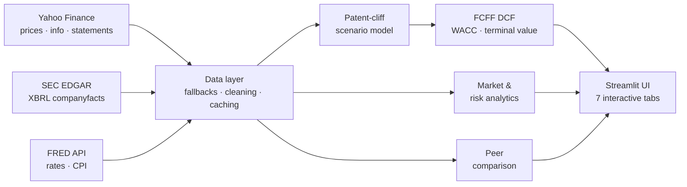

<div align="center">

# 📊 MRK Equity Research & Valuation Dashboard

### *What happens to Merck's value when Keytruda loses patent protection?*

An interactive equity research tool that turns **live market data, SEC filings, and macro indicators** into a scenario-driven DCF valuation of Merck & Co. (NYSE: MRK).

[](https://www.python.org/)
[](https://streamlit.io/)
[](https://pandas.pydata.org/)
[](https://plotly.com/python/)
[](https://www.sec.gov/edgar)
[](#%EF%B8%8F-limitations--honest-caveats)

**[🚀 [Live Demo](https://mrk-equity-research-valuation.streamlit.app/)](#)** · **[📸 Screenshots](#-screenshots)** · **[🧠 Methodology](#-methodology)** · **[⚡ Quick Start](#-quick-start)**

</div>

---

## 🎯 The Problem

Merck's largest product, **Keytruda**, accounts for a large share of company revenue, and its patent protection is expected to start expiring late this decade. Analysts disagree on how much value that "patent cliff" destroys, and most public models hide their assumptions in a spreadsheet.

**This project makes the assumptions visible and adjustable.** Move a slider for the erosion rate, the cliff year, or the cost of capital, and the revenue forecast, free cash flow, and implied share price all update instantly.

---

## ✨ Highlights

| | Feature | What it does |
|---|---|---|
| 🧪 | **Patent-cliff scenario engine** | Splits Keytruda from the rest of the business and models Bull / Base / Bear erosion paths |
| 💰 | **Linked DCF valuation** | FCFF model driven by the selected scenario; WACC built from CAPM and live capital-structure inputs |
| 🏛️ | **SEC EDGAR pipeline** | Pulls 10-K facts from the XBRL API, merges multiple tags across years, derives an EBIT proxy where Merck reports none |
| 📈 | **Market & risk analytics** | Volatility, drawdown, cumulative return, regression beta vs. the S&P 500 |
| 🆚 | **Peer comparison** | MRK vs. PFE, ABBV, BMY on P/E, P/S, yield, beta, and market cap |
| 🏦 | **Macro context** | Optional FRED integration (10Y Treasury, Fed Funds, CPI) |
| 📥 | **Exportable** | Every table downloads as CSV |

---

## 📸 Screenshots


| Overview | Patent Cliff Scenarios |
|:---:|:---:|
|  |  |

| DCF Valuation | Peer Comparison |
|:---:|:---:|
|  |  |

---

## 🏗️ Architecture



**Tabs:** Overview · Market Data · Financial Statements · Patent Cliff · DCF Valuation · Peer Comparison · Methodology

---

## 🧠 Methodology

<details>
<summary><b>Click to expand the formulas</b></summary>

| Component | Formula |
|---|---|
| Daily return | `P(t) / P(t-1) - 1` |
| Annualized volatility | `std(daily returns) × √252` |
| Beta | `Cov(r_stock, r_market) / Var(r_market)` (5y daily, vs. S&P 500) |
| Cost of equity (CAPM) | `Rf + β × ERP` |
| WACC | `E/(D+E) × Ke + D/(D+E) × Kd × (1 − t)` |
| FCFF | `EBIT × (1 − t) + D&A − CapEx − ΔNWC` |
| Terminal value | `FCFF(n) × (1 + g) / (WACC − g)` |
| Equity value | `Enterprise value − debt + cash` |
| EBIT proxy | `Pre-tax income + interest expense` (when operating income isn't reported) |

**Patent-cliff logic**

```
Other revenue_t = Other revenue_(t-1) × (1 + non-Keytruda growth)
Keytruda_t      = Keytruda_(t-1) × (1 + pre-cliff growth)    if year < cliff year
                = Keytruda_(t-1) × (1 − erosion rate)        if year ≥ cliff year
```

Bull / Bear cases scale the base erosion rate by 0.6× and 1.5× (capped at 85%).

</details>

---

## 🛠️ Engineering Decisions

The part I'm proudest of isn't the valuation math. It's making a data app that **fails honestly** when its sources are flaky.

| Problem | Decision |
|---|---|
| Yahoo's scraped `info` endpoint is often empty or rate-limited | Layered fallbacks: `fast_info` → balance sheet → dividend history → quarterly statements → regression beta |
| Caching a failed request hides the error for an hour | Failures **raise** instead of returning `{}`, so they are never cached, and the UI shows the real error |
| One XBRL tag per metric leaves gaps when companies change tags | Merge all candidate tags; earlier tags take priority, later ones fill gaps |
| Mixed fiscal years can corrupt margins | `latest_row()` ensures revenue and EBIT always come from the **same** year |
| Missing data tempts you to `fillna(0)` | **Never fabricated.** Gaps render as `—`; placeholders trigger a visible warning |
| Yahoo changed the `dividendYield` units between versions | Computed from trailing-12-month dividends ÷ price instead |
| One `try/except` around all sources lost everything on any failure | Each source loads independently, so SEC data survives a Yahoo outage |

---

## ⚡ Quick Start

```bash
# 1. Clone
git clone https://github.com/<your-username>/<your-repo>.git
cd <your-repo>

# 2. Install
pip install -r requirements.txt

# 3. Run
streamlit run app.py
```

**`requirements.txt`**
```
streamlit
yfinance>=0.2.40
pandas
numpy
plotly
requests
```

**Optional:** paste a free [FRED API key](https://fred.stlouisfed.org/docs/api/api_key.html) into the sidebar to enable macro charts.

> **Tip:** if market data comes back empty, run `pip install -U yfinance` and click **Clear cached data / retry** in the sidebar.

---

## 🧰 Tech Stack

- **Language:** Python
- **App framework:** Streamlit
- **Data & analysis:** pandas, NumPy
- **Visualization:** Plotly
- **Data sources:** Yahoo Finance (`yfinance`), SEC EDGAR XBRL API, FRED API

---

## ⚠️ Limitations & Honest Caveats

Good analysts state what their model *can't* do.

- **Simplified scenario model.** Erosion is geometric (constant % per year). Real biosimilar uptake is usually steeper early and flatter later. No product-level, geographic, or litigation modelling.
- **Constant margins.** EBIT margin is held flat even as high-margin Keytruda revenue falls, which likely overstates future profit.
- **Terminal value sensitivity.** Gordon Growth assumes stable growth, so a forecast that ends mid-erosion will distort the result. The terminal value is typically the largest share of EV.
- **Low-beta WACC.** Merck's regression beta is low, which can produce a WACC below what most analysts use. WACC is an editable input, so test higher values.
- **Data caveats.** Yahoo data can be incomplete; SEC XBRL tags may need reconciliation against the filed 10-K. The default Keytruda revenue is an illustrative starting value to be replaced with the latest reported figure.

> **Educational project. Not investment advice.**

---

## 🗺️ Roadmap

- [ ] Sensitivity table (WACC × terminal growth) and tornado chart
- [ ] Exit-multiple terminal value as a cross-check
- [ ] Mid-year discounting convention
- [ ] Margin erosion linked to Keytruda's revenue mix
- [ ] Bottom-up beta from peer set (unlever / relever)
- [ ] Institutional holders table from 13F data
- [ ] Unit tests for the valuation and SEC-parsing functions
- [ ] Event annotations on price and volume charts

---

## 📚 What I Learned

- Building **resilient data pipelines** around unreliable public APIs
- Translating **corporate finance theory** (CAPM, WACC, FCFF, terminal value) into working, testable code
- Parsing the **SEC XBRL schema** and handling tag changes across fiscal years
- Designing a UI where **assumptions are first-class**, so users can interrogate the model instead of trusting it

---

## 👤 Author

Khulan Ganzorig
[LinkedIn](https://linkedin.com/in/your-profile) · [GitHub](https://github.com/your-username) · your.email@example.com

*If this project was useful or interesting, a ⭐ helps others find it.*

---

<div align="center">
<sub>Data: Yahoo Finance · SEC EDGAR · FRED. Built for educational use.</sub>
</div>
